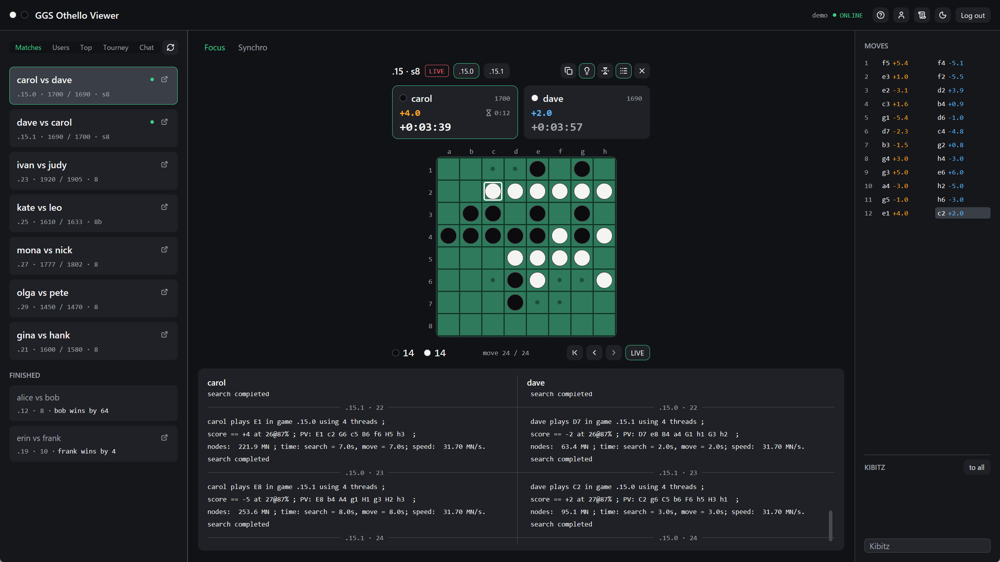
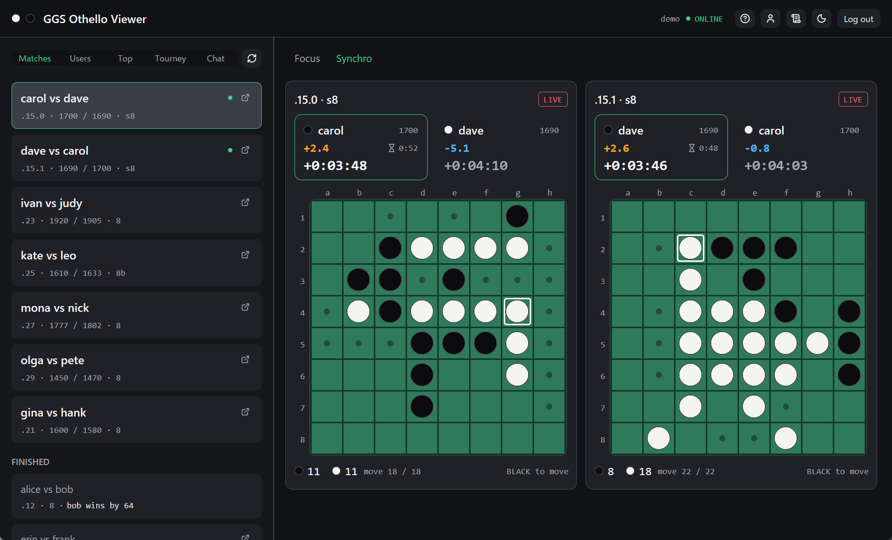
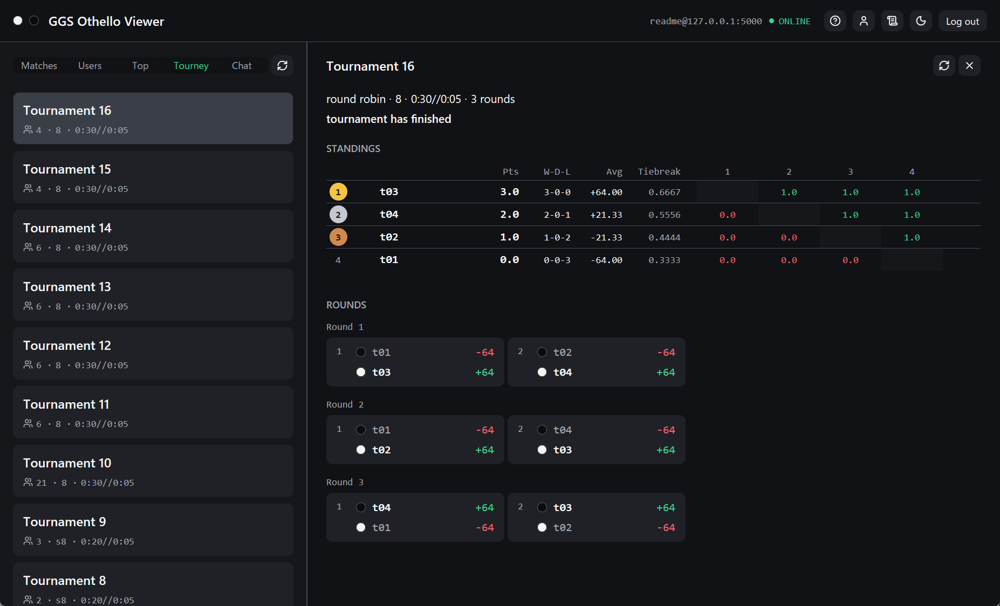

# GGS Othello Viewer

A desktop app for watching Othello games on the [Generic Game Server](https://skatgame.net/mburo/ggs/) (GGS).



## Features

- **Matches**: running and recently finished matches
- **Users**: logged-in users and their past games
- **Top**: the rankings
- **Tourney**: tournaments run by `/td`, with standings and rounds
- **Chat**: channels and private conversations
- **Engine logs**: the search logs the players' engines post to their GGS channels, side by side under the board and
  divided at each move. The logs button turns them on or off, and the choice is kept for the next start. While they
  are on, the app joins the log channels of the games on screen and leaves them afterwards.





## Run

Requires Rust 1.99.1 or later. On Linux, first install the packages listed in
[GPUI Kit Installation](https://gpui-kit.com/docs/installation).

```sh
cargo run --release
```

To try the app without a server, run a scripted session. To skip the login form, give a server and a login:

```sh
cargo run --release -- --demo
cargo run --release -- --connect HOST:PORT --login NAME [--password PW]
```

## Data

Settings, logins and chat history are kept in `ggs.db` in:

| OS | Folder |
|---|---|
| Windows | `%APPDATA%\ggs-othello-viewer` |
| macOS | `~/Library/Application Support/ggs-othello-viewer` |
| Linux | `~/.local/share/ggs-othello-viewer` |

Saved passwords are kept in the OS credential store.

## Development

```sh
cargo fmt --check
cargo test --locked
cargo clippy --locked --all-targets -- -D warnings
```

[docs/PROTOCOL.md](docs/PROTOCOL.md) describes the GGS messages the app uses.

## License

GPL-3.0-or-later. See [LICENSE](LICENSE).

The protocol handling is a reimplementation of the GGSA client by Michael Buro and Daniel Lidström,
which is licensed under GPL version 2 or later.
